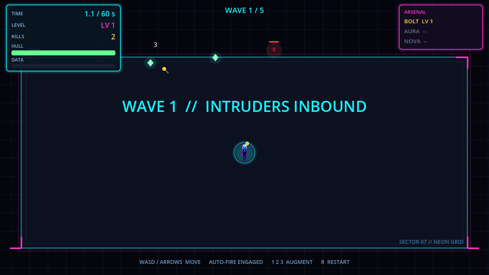

<div align="center">
  <h1>GameDream</h1>
  <p><strong>Turn a text prompt into a playable, verified game prototype.</strong></p>

  <p>
    
    
    
    
  </p>
</div>

GameDream is an AI game-development harness. It combines a spec/composer layer,
engine adapters, and a tool-using agent with real verification: generated
projects must compile, boot, exercise their core loop, and produce a screenshot
before they are considered playable.

It currently ships working 2D slices for **Godot**, **Web**, and **Unity**, with
shared content and engine-specific runtimes. Unreal is a future adapter.



## Why GameDream

Most AI game demos stop at generated code. GameDream treats the game itself as
the deliverable:

- **Spec-driven composition** — a prompt resolves to a template and module set,
  with managed/user file boundaries and a lockfile.
- **Verification, not vibes** — G1 schema/lockfile, G2 import/parse, G3 boot and
  core-loop markers, plus opt-in screenshot and vision gates.
- **Engine-aware output** — native Godot projects, Web ESM/Phaser projects, and
  Unity 6 source projects.
- **Agent workflow built in** — structured sessions, durable checkpoints,
  parallel candidates, a plugin tree, explicit cache boundaries, and MCP tools.
- **Local asset generation** — optional ComfyUI integration produces transparent
  sprites for generated games.

## Quick Start

### Requirements

- Node.js 22+
- pnpm 9 via Corepack (`corepack enable`)
- Godot 4.4+ for Godot verification (optional for Web/Unity-only work)
- Unity 6 for Unity runtime checks (optional; static checks work without it)

### Install and build

```bash
git clone git@github.com:MatchFive/game-dream.git
cd game-dream
corepack enable
corepack pnpm install
corepack pnpm build
```

Create a local configuration from the example. The CLI loads `.env` from the
current directory; explicit environment variables take precedence.

```bash
cp .env.example .env        # Windows: Copy-Item .env.example .env
```

### Generate a demo

The deterministic fake provider needs no API key and is the fastest way to
check the pipeline:

```bash
node packages/cli/dist/index.js create \
  "做一个俯视角动作 RPG，有背包和 1 个敌人" \
  --out tmp/my-game \
  --provider fake \
  --modules modules \
  --templates templates
```

Verify the generated project:

```bash
node packages/cli/dist/index.js verify --path tmp/my-game
```

Expected gates:

```text
G1: pass
G2: pass
G3: pass
```

If Godot is not installed, G2/G3 report `skip` instead of a false pass.

### Use a real model

Set an OpenAI-compatible provider in `.env`, then switch the provider:

```ini
OPENAI_API_KEY=...
OPENAI_BASE_URL=https://api.openai.com/v1
GAMEDREAM_MODEL=gpt-4o-mini
GAMEDREAM_VISION_MODEL=gpt-4o-mini
GODOT_BIN=C:\path\to\Godot_v4.4.1-stable_win64_console.exe
```

```bash
node packages/cli/dist/index.js develop \
  --case cases/development/survivor-demo.json \
  --out build/survivor-demo \
  --provider openai \
  --cache-breakpoints
```

`--provider auto` uses the configured provider when `OPENAI_API_KEY` is set;
otherwise it falls back to the deterministic fake provider.

## Demo

The repository contains seven Godot benchmark templates: action RPG,
platformer, shooter, roguelike, tower defense, puzzle, and survivor. Web and
Unity now also have platformer, shooter, roguelike, tower-defense, puzzle, and
survivor slices in addition to the shared action-RPG M1 campaign.

The screenshot above is the neon survivor test slice produced through
`dream develop`, with transparent sprites generated by ComfyUI and integrated
into the Godot project. See [ComfyUI assets](docs/comfyui-assets.md) for the
asset workflow.

## How It Works

```text
Prompt / GameSpec
      │
      ▼
Template + module resolver ──► lockfile
      │
      ▼
Engine composer
  ├─ Godot: project.godot + scenes + GDScript
  ├─ Web: ESM simulation + Phaser/Canvas renderer
  └─ Unity: C# source project + batchmode verifier
      │
      ▼
Agent loop (tools, sessions, checkpoints, plugins)
      │
      ▼
G1 schema ─► G2 import/parse ─► G3 boot/loop ─► G6 screenshot/vision
      │
      ▼
Playable prototype or structured repair loop
```

### Agent features

- Append-only `AgentSession` with JSONL generation headers and durable checkpoints.
- `--resume` and `--resume --fork <checkpoint-id>` for branching a development run.
- `--candidates N` to generate several projects and select by verification score.
- `--max-tokens N` for a hard stop on provider-reported total token usage, plus
  `--max-prompt-tokens N` for prompt usage.
- Studio queues new Agent batches while one is active; queued runs appear in
  `/api/agent` and can be canceled before they start.
- Studio Policy editor sets per-tool `allow` / `ask` / `deny` rules and a default
  mode for future Agent runs.
- Replaceable plugin tree with tool overrides and step/tool/finish hooks.
- Explicit `prompt_cache_key` boundaries when the provider supports them.
- MCP bridge for Godot editor tools, discoverable through `mcp.json`.

## Studio

`dream studio` opens a local project studio and infinite Asset Canvas. The
studio indexes module assets, screenshots, audio, and generated images; stores
canvas layout under `.gamedream/studio/`; records verification runs; and can
submit real ComfyUI jobs with transparent PNG output. The UI defaults to
Chinese and switches between Chinese and English from the top bar. Batch
generation creates up to four independently seeded variants per request.

```bash
corepack pnpm build
node packages/cli/dist/index.js studio --path . --open
```

- `/` — preview, G1–G3 gates, run history, live Agent thread, approvals,
  candidates, session, assets, evidence
- `/assets` — infinite canvas, generation, uploads, build selection; selected
  assets are staged into `game/build-assets/` with a manifest. **Animate**
  generates a 2–4 frame transparent keyframe sequence node with playback and
  atlas packing; **BGM** generates a 30-second audio asset through ComfyUI.
  Assets can be renamed without moving the underlying file.
- Playtest — Web builds open in the preview pane with a `/play/` base path;
  Godot launches in a separate window when `GODOT_BIN` is configured

See [Studio](docs/studio.md) for the API and current limits.

## CLI

| Command | Purpose |
|---|---|
| `dream doctor` | Detect Node, Godot, Unity, and provider configuration |
| `dream create` | Prompt → GameSpec → template → generated project |
| `dream compose` | Compose a GameSpec and module set into a project |
| `dream verify` | Run G1–G3 and optional G6 visual gates |
| `dream develop` | Run the tool-using developer loop |
| `dream studio` | Open the local project studio and Asset Canvas |
| `dream screenshot` | Capture a generated project |
| `dream web` | Compose, verify, screenshot, and package Web projects |
| `dream unity` | Compose, verify, build, smoke, and screenshot Unity projects |
| `dream godot` | Package and export Godot projects |
| `dream benchmark` | Run all benchmark cases and report playability |
| `dream eval` | Run prompt → GameSpec template evaluation |

During development, run the TypeScript entry point directly:

```bash
corepack pnpm exec tsx packages/cli/src/index.ts doctor
```

After `corepack pnpm build`, use `node packages/cli/dist/index.js` or add the
built CLI to your PATH.

## Configuration

| Variable | Purpose |
|---|---|
| `OPENAI_API_KEY` | OpenAI-compatible chat/vision key |
| `OPENAI_BASE_URL` | Chat/vision endpoint, default `https://api.openai.com/v1` |
| `GAMEDREAM_MODEL` | Development model |
| `GAMEDREAM_VISION_MODEL` | Screenshot review model |
| `GAMEDREAM_TIMEOUT_MS` | Provider request timeout |
| `GODOT_BIN` | Godot 4.4+ console executable |
| `UNITY_BIN` | Optional Unity 6 editor path |
| `COMFYUI_URL` | Local ComfyUI server for asset generation |
| `COMFYUI_WORKFLOW` | Qwen Image workflow JSON |

`G2`/`G3` skip when Godot is missing. `--runtime` is required for Unity
batchmode verification; static Unity checks do not claim a runtime pass.

## Project Layout

```text
packages/
  core/       schemas, resolver, composer, lockfile
  cli/        dream CLI and development tools
  agent/      agent loop, sessions, providers, plugins, multi-agent
  godot/      Godot adapter and headless runner
  web/        Web composer, verifier, screenshots, packaging
  unity/      Unity composer, verifier, build/smoke helpers
modules/      reusable Godot modules
templates/    game templates and engine projects
cases/        benchmark and development cases
skills/       agent skills and starter kits
docs/         design, architecture, release, and evidence docs
```

## Development

```bash
corepack pnpm typecheck
corepack pnpm test
corepack pnpm build
```

Focused checks:

```bash
corepack pnpm vitest run packages/agent/test
corepack pnpm vitest run packages/cli/test
```

The release acceptance helper runs Web, Godot, and Unity checks against
already-built projects:

```bash
corepack pnpm release:accept \
  --web ./web-game \
  --godot ./godot-game \
  --unity-dir ./unity-game \
  --godot-bin "$GODOT_BIN" \
  --unity-bin "$UNITY_BIN"
```

## Documentation

- [Architecture and technical choices](docs/architecture.md)
- [Development roadmap and backlog](docs/roadmap.md)
- [Design spec](docs/superpowers/specs/2026-11-12-gamedream-design.md)
- [Web deployment](docs/deploy-web.md)
- [Godot release](docs/release-godot.md)
- [ComfyUI transparent sprites](docs/comfyui-assets.md)
- [Studio and Asset Canvas](docs/studio.md)
- [Tool permissions](docs/permissions.md)
- [Development cases](cases/development/README.md)
- [P1 verification evidence](docs/evidence/p1/README.md)
- [Demo test evidence](docs/evidence/demo-test/README.md)

## Status and Limitations

GameDream is under active development. Godot is the most complete engine path;
Web slices have real deterministic gameplay, while Unity genre slices are
deterministic smoke/coverage slices that verify build, runtime, and win markers.
Unreal and 3D production pipelines are not implemented. Generated content is a
starting point, not a substitute for game design review.

The repository is licensed under Apache-2.0; see [LICENSE](LICENSE).
